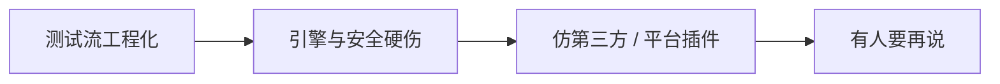

# Roadmap

> **用途**：公开后「接下来做什么」。  
> **远程**：[GitHub qualitest-hq](https://github.com/qualitest-hq)（主仓）· [Gitee qualitest-hq](https://gitee.com/qualitest-hq)（只读镜像）  
> 不绑定硬性日期；条目可能推迟、拆分或取消。

| 标记 | 含义 |
| ---- | ---- |
| 🚧 Now | 当前优先 |
| 📋 Next | 下一阶段 |
| 🔭 Later | 尚未排期 |
| 🔬 Exploring | 评估中，不承诺 |
| ✅ Done | 已落地（只记里程碑，不当 CHANGELOG） |



```text
测试流工程化  >  跑流/密钥硬伤  >  仿第三方与平台插件（评估）  >  其余看反馈
```

> **命名**：JetBrains「Qualitest Helper」市场上架已在 Done（1.2）。**平台插件**（Exploring 6.2）指质衡内可装卸扩展：既含**被测/环境运行面**，也含**测试流呈现面**（样式与 UI 贡献槽），见 [docs/platform-plugins.md](./docs/platform-plugins.md)；与 IDEA 插件不是同一件事。

---

## 🚧 Now

（暂无）

---

## 📋 Next

（暂无）

---

## 🔬 Exploring

不排期、不承诺版本。

| ID | 方向 | 说明 |
| -- | ---- | ---- |
| 6.1 | 可私有化的垂直造流模型 | 先把外接 LLM + Staging 做稳，训练样本与通过率够了再评估。**产出**是一份可部署的微调权重（约 7B～14B 开源基座 + LoRA/SFT），接现有 AI 通道，服务内网与调用成本；不替代多模型接入，也不是从零预训练。**训练集**来自真实造流/修流：用户意图 → 调了哪些工具、提交了什么改图 → Staging/校验失败后再改到通过。时间未定。靶场以 [`qualitest-demo-mall`](https://github.com/qualitest-hq/qualitest-demo-mall) 为主。 |
| 6.2 | 平台插件（运行端 + 界面端） | **契约优先（JSONC）**。被测特殊面 → 插件；能力私有于插件。被测旁 **默认 CLI**（install/uninstall，配置走环境 `config`/`configSchema`）。文档示意：被测库存档点（SQL/Redis 等整包存档、断点读档）+ 拨钟（改被测机系统时间，仅靶场）；可运行样本后置（官方 ops CLI：**Go**）。`invoke(pluginId, capability, …)`。见 [platform-plugins.md](./docs/platform-plugins.md)。**不做**：开放业务能力名录；默认常驻 agent 守护；改质衡自身时钟/库；公开热装商店；不与 1.2 JetBrains 市场混名。 |

---

## ✅ Done

只记已落地的方向性条目；细节以代码为准。

| ID | 任务 | 说明 |
| -- | ---- | ---- |
| 1.1 | GHCR 镜像 | `ghcr.io/qualitest-hq/qualitest-app` / `qualitest-web`；workflow `ghcr.yml`；Compose / README / deploy 已附 pull |
| 1.2 | JetBrains 插件市场上架 | [Qualitest Helper](https://plugins.jetbrains.com/plugin/34434-qualitest-helper) 已通过审核 |
| 1.3 | 插件仓首个 tag `v1.0.0` | 已打 tag；GitHub Release 附 ZIP |
| 3.1 | 简易 HTML 报告 | Run 导出单文件 HTML；运行库「导出报告」下载；失败摘要与节点卡片 |
| 3.11 | 运行详情体验 | 页眉与失败摘要、时间线短摘要、点选高亮画布；场景跑入口收束到左栏「运行场景」 |
| 3.2 | 失败摘要深化 | 失败摘要挂本步关联 flow 键值（运行详情 + HTML 报告）；占位按合法路径识别 |
| 3.3 | 测试流目录 / 分组 | 列表左树右表 + 可嵌套目录；流挂 `flow_group_id`；子流选择按组；`list_flows` / `create_flow` / `update_flow_meta` 带分组字段 |
| 3.4 | 测试套件批量跑 | 可保存套件（流×场景）+ `suite_run` 历史；套件页一键串行；结果可回看；`?runId=` 进画布；`POST /triggerBatch` 供短批 |
| 3.12 | 项目成员角色与细粒度权限 | 全站可配角色与权限矩阵；成员按 capabilities 门禁（流/接口/套件/环境/AI/MCP/Token）；MCP 改按角色权限；历史 `developer`→`backend` |
| 7.1 | 脚本加密与报文工具 | `ctx` / `api` 同名挂载：摘要（含 SM3）、HMAC、RSA 签验与加解密（PEM / 裸 Base64 / 证书）、AES-GCM 与 CBC/ECB、国密 SM2/SM4、`urlEncode`、`xmlParse/xmlStringify`、`signContent`；可仿支付宝 RSA2、微信支付 v2 / v3 回调 |
| 7.2 | XML 响应自动解析 | Content-Type 为 xml，或 `text/plain` 正文以 `<?xml` / `<xml>` 开头时转对象（去根节点、防 XXE）；`{{http.body.xxx}}`、断言、条件、提取直接取字段；原文在 `http.bodyText` 与步骤报告；`responseKind` / `expectedResponseKind` 新增 `xml` |
| 3.13 | 测试流步数上限与写锁 | 场景可配 `maxSteps`（默认 200 / 封顶 1000），超限合成失败步并展示 Run 级错误；MCP/Web AI 端锁 + 行锁内增量写图，`release_flow_lock` 显式释锁 |
| 3.14 | 失败后继续（alwaysRun） | 节点 `data.alwaysRun`（http/script/assign/subflow 属性开关）；业务失败且非 prompt 暂停后沿边继续：未标记 → `bypassed`，alwaysRun 成功 → `continued`、失败 → `continued_failed`（不盖首错、不中断后续）；未求值 condition → `bypassed` 后扇出、汇合去重；画布/时间线/HTML 报告有对应态 |
| 3.15 | `alwaysRun` 与节点布尔字段图校验 | 保存 / Staging：`alwaysRun`、`snapshotBefore` 须为 JSON 布尔；`alwaysRun` 仅 http/script/assign/subflow，`snapshotBefore` 仅 http/script/assign；非法类型或挂错节点 → error。运行时与面板只认布尔 true；AI 写图对允许类型常见脏值收成布尔 |
| 2.1 | 演示动图 | README + 落地页已插 `debug-200` / `canvas-glance` / `ai-diff` / `mcp-write` / `mcp-run` |
| 7.3 | HTTP 节点重试直到通过 | `data.retryUntil`：最多请求 N 次（默认 1）/ 间隔 M ms / 可选 `until` 通过条件；同一 HTTP 节点反复请求直到业务状态到位 |

---

## 🔭 Later

不绑版本号。按 Issue / 真实踩坑再排；下面只是已知方向。

### 测试流工程化（不改画布 / 固定节点核心；可逐步做）

按投入产出大致顺序，遇真实需求再提排期。

| ID | 任务 | 说明 |
| -- | ---- | ---- |
| 3.5 | 单流 JSON 导入导出 | 基于已有 `graphJson`；便于备份、评审、Agent 读写 |
| 3.6 | 定时调度跑流 / 套件 | cron 调现有 trigger |
| 3.7 | 数据驱动批跑 | CSV / 数据集 → 多行 `flowSeed` 循环触发同一张图 |
| 3.8 | 全场景一键跑 | 对 `meta.scenarios` 批量 trigger |
| 3.9 | 接口变更一键对齐 | 在现有健康度 / 变更提示上，支持应用到节点 |
| 3.10 | 流水线跑流 | 有人要接 CI 再做：仓库脚本优先（curl 调现有 trigger → 轮询 → 失败 `exit ≠ 0`）；附带 JUnit XML 导出；不必先做正式 CLI |

刻意不做（会动核心或另开引擎）：循环节点、同流压测、独立 DB 节点。

### 硬伤（用户能直接感到痛）

| ID | 任务 | 说明 |
| -- | ---- | ---- |
| 4.1 | 测试流超时 / 熔断 | `flow.node.timeout`、`flow.run.timeout` |
| 4.2 | 子流循环引用 / 深度限制 | 防跑飞 |
| 4.3 | AI apiKey 加密与日志脱敏 | 生产可信底线 |
| 4.4 | AI 连接测试 + LLM 韧性 | 超时 / 重试 / 熔断 |

生产须换强密钥，并关 Druid 或加白名单。

### 仿第三方（外联仿真）

按表序逐项做，一次只开一项。靶场侧配套为 `qualitest-demo-mall` 的 B6（模拟支付单 + 回调幂等），建议在 7.2 之后接上。

先分清谁调谁，再选能力：

| 要测什么 | 谁调谁 | 质衡怎么演 | 对应 |
| -------- | ------ | ---------- | ---- |
| 被测系统能否正确处理渠道通知（如微信退款结果通知） | 质衡 → 被测系统 | 测流 HTTP 节点扮渠道，主动打被测系统 notify | 7.1 / 7.2 / 7.3 |
| 外部事件或 CI 拉起一次 Run | 外部 → 质衡 | 触发入口启流 | 7.4 |
| 被测系统是否主动推送下游（如退款完成推商家 / ERP webhook） | 被测系统 → 质衡 | 质衡扮下游：7.4 固定地址收报文落库；断言可用 7.3 轮询查收件记录，或后置 7.5 事件式等到匹配 | 7.4（必要）/ 7.3 或 7.5 |
| 被测系统调第三方是否正确（如商城调微信「申请退款」） | 被测系统 → 质衡（常驻） | 挡板扮第三方网关，返回预设响应并记录请求 | 7.6 |

| ID | 任务 | 说明 |
| -- | ---- | ---- |
| 7.4 | 可配置入口（Webhook） | **唯一入站面**（不另开第二套回调 URL）。项目内自定义 path/slug 的固定地址，分两种用途。**启流**：绑定流与默认场景/环境，入口独立密钥（勿复用长期 Project Token），可选把 query/header/body 写入 flowSeed，异步返回 runId + 查结果，`paused` 对 CI 直接失败；供 CI、定时（3.6 / 3.10）。**收报文**：扮下游接收地址，被测系统像配商家通知地址一样配一次；不要求带质衡专用凭证；报文原样落库（headers、到达时间）并可查询/断言；按被测系统约定应答（如固定返回 `success`）。验证「有没有推到、内容对不对」优先：收件落库 + 7.3 轮询断言。固定 `/api/project/runs` 仅作调试旁路。现仅 MCP 可用令牌跑流 |
| 7.5 | 等待回调节点（可选后置） | **不另开 URL**，只消费 7.4 收报文落库：节点配置入口 + 匹配条件（如 `body.refundNo == {{flow.refundNo}}`）+ 超时；先查已收报文，无则暂停（`await_callback`）等到达，匹配后写入 flow 继续。防伪造靠被测系统真实验签（7.1），不加质衡令牌。与 7.4 关系：7.4 是门和信箱，本节点是「等到这封信再往下走」的编排体验；业务能力与「7.4 落库 + 7.3 轮询断言」等价，可后置。渠道回调被测系统、靶场无对外推送前均不必做 |
| 7.6 | 挡板（Mock） | 质衡常驻扮第三方网关，被测系统把外联地址配到质衡：项目级规则（方法 + 路径 → 响应模板，支持占位）、延迟 / 失败注入、入站请求记录与断言查询；需处理并发 Run 隔离。例：商城调微信「申请退款」，挡板返回成功 / 失败，流里断言商城发出的参数与签名。可先只做静态响应 + 请求记录。**形态预留**：规则引擎可落在核心入站面，渠道包按 6.2 `egress.mock` 插件化。**方向（不承诺）**：SDK 写死微信等域名时，叠加 6.2 `egress.intercept.*`（被测侧 hosts/DNS/边车 + 测试 CA），见 [platform-plugins.md](./docs/platform-plugins.md) §3.1（拦截）/ §7；pinning 场景可能无法覆盖 |

### 有空或有人要再说

| ID | 任务 |
| -- | ---- |
| 5.1 | 节点处理器 Spring 注入（`Map<String, NodeHandler>`） |
| 5.2 | 流程合并重构 + 补测（`GraphMerger` 等） |
| 5.3 | 事务 / 索引 / 分页 |
| 5.4 | 测试覆盖补强（对着真实 Bug 补，不为覆盖率） |
| 5.5 | 画布独立快照节点（执行委托 6.2 数据类插件，与现有 `snapshotBefore` 同向） |
| 5.6 | Dev Container / Codespaces |
| 5.7 | 前端打进 JAR（可选单容器） |
| 5.8 | GitHub Discussions |
| 5.9 | Dependabot 常态化合入 |
| 5.10 | 双远程：GitHub 为主，Gitee 只读镜像 |
| 5.11 | 报告导出可选 AI 建议 | 仅 HTML、默认关；失败 Run 勾选后现算只读诊断（可能原因与排查步骤）；不写入 JUnit |
| — | Helm Chart 实测（骨架已有，谁用谁验） |

---

## 发布约定

| 仓库 | 策略 |
| ---- | ---- |
| `qualitest` / `qualitest-demo-mall` | semver；**不发** GitHub Release / 根目录 CHANGELOG |
| `qualitest-intellij-plugin` | 独立 semver；Release 附 ZIP；`changeNotes` 在 Gradle；首发 `v1.0.0`；修 BUG 升 PATCH |

---

## 仓库

| 仓库 | 端口 | GitHub | Gitee（只读镜像） |
| ---- | ---- | ------ | ----------------- |
| qualitest | Web / API **5180** / **8800**；MySQL / Redis **3306** / **6379** | [GitHub](https://github.com/qualitest-hq/qualitest) | [Gitee](https://gitee.com/qualitest-hq/qualitest) |
| qualitest-demo-mall | API **8801**；Compose UI **5181** | [GitHub](https://github.com/qualitest-hq/qualitest-demo-mall) | [Gitee](https://gitee.com/qualitest-hq/qualitest-demo-mall) |
| qualitest-intellij-plugin | — | [GitHub](https://github.com/qualitest-hq/qualitest-intellij-plugin) | [Gitee](https://gitee.com/qualitest-hq/qualitest-intellij-plugin) |
