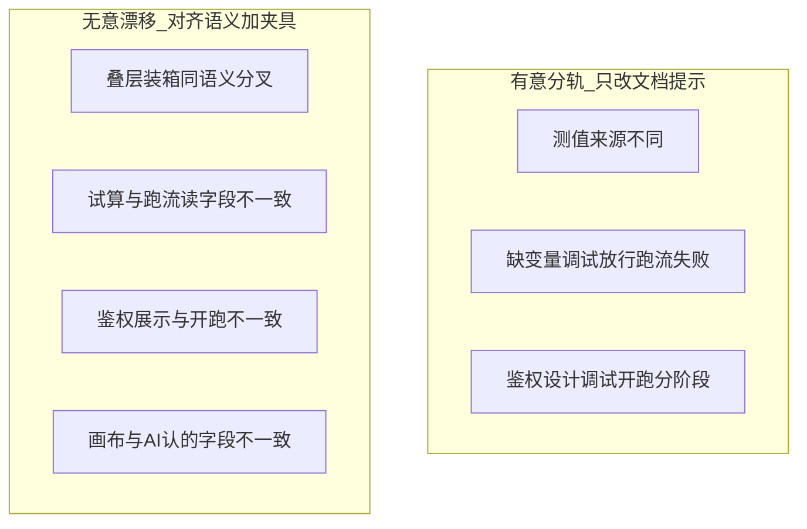

# 多口径 / 职责重叠审计

> **状态**：审计纪要（2026-03-28）· 仅本稿，**尚未**改产品行为或其它文档口径。  
> **范围**：主仓 `qualitest`（质衡平台）。  
> **相关（只读对照）**：[flow-variables-and-values.md](./flow-variables-and-values.md) · [project-summary.md](./project-summary.md) · [flow-contract-2.0.md](./flow-contract-2.0.md) · [ai-staging.md](./ai-staging.md)

「修 A 炸 B」常见原因：同一业务事实在**调试台 / 正式跑流 / 画布试算 / AI·MCP** 多处各自裁决；文档有时还写成「同一套」。本文分清**有意分轨**与**无意漂移**，并记下建议修法——**不是**要把调试台和跑流合成一条链路。

口诀：**该不同的是场景策略；不该不同的是同一种业务语义的解释。**

---

## 1. 边界：不会合太过

调试（试接口、改测值、宽松占位）与跑流（图上下文、严格占位、节点覆盖、鉴权注入）**场景本来就不同**。

| 有意分轨（保留） | 业务上为何合理 |
|------------------|----------------|
| 测值从哪来 | 调试在台本屏改参数；跑流用接口默认 + 节点覆盖——来源可以不同 |
| 缺变量怎么办 | 调试先发出去看响应；正式跑流缺 `{{token}}` 应失败，避免假绿 |
| 鉴权何时出现 | 设计图不落死托管头；调试可选手动带；开跑再按 Profile 注入 |
| 上传文件形态 | 调试选本地文件；跑流用素材库路径 |
| 图能不能存/跑 | 画布地板拦脏 JSON；能不能开跑以服务端门禁为准 |

**无意漂移**才要盯：产品（或旧文档）声称「同一种语义」，前后端各写一份实现却静默分叉。

**修法总原则：**

1. 同语义以**跑流（后端）**为准——调试前端向它对齐，或 UI 标明「仅预览、以开跑为准」。
2. 实现继续两份可以——靠共享夹具锁「同输入 → 同语义输出」，不抽共享运行时。
3. 有意分轨只改文档/提示——不改严格度、不合通道、不把三阶段鉴权合成一步。

---

## 2. 用户问题总表

| 用户问题 | 业务期望 | 归类 | 怎么处理 |
|----------|----------|------|----------|
| 同样叠法/装箱，调试与跑流结果却不同？ | 测值来源可不同；规则应一致 | 无意漂移 | 对齐规则 + 夹具 |
| 调试缺变量仍发出，跑流却报错？ | 可以——正式更严 | 有意分轨 | 文案/提示说清（见 §4） |
| 面板断言试算过了，跑流断言挂？ | 试算=预览跑流，不该对不上 | 无意漂移 | 夹具对齐求值 |
| 卡片写 client，开跑却带 admin？ | 当事实则对齐；仅提示则改文案 | 展示口径 | 二选一做干净 |
| 画布能配，AI 写了被剥？ | 同一图契约 | 目录漏改 | 交集强测 |
| 勾了失败后继续仍提前停？ | 勾选应生效 | 允许集漏改 | 补测允许 type |



---

## 3. P0 · 「这条请求最终长什么样」——叠层与装箱

### 3.1 业务在说什么

默认测值叠上手改/节点覆盖，再变成真实 HTTP（Cookie 合成、空 query 不发、空格编码等）。用户关心：**同一份「该发出的内容」解释是否稳定。**

测值来源、文件用 File 还是路径——可以不同；**怎么叠、怎么装箱**若声称一致，结果应一致。

### 3.2 用户会踩的坑

- 调试里 body 有内容，跑流没 body（或反过来）
- AI 把字段写在覆盖根上：跑流能发出，画布预览却丢
- 修一侧装箱规则，另一侧 CI 不红

### 3.3 为何像冗余业务（mode / example 多层）

产品只问两件事：**发不发 body？发什么内容？** 落库却摊成多层，名字还都叫 example：

```text
① request_config.body.mode               ← 结构：none / json / urlencoded / …
② request_config.body.json.example       ← 结构槽：OpenAPI 残留；编辑时也可能暂存正文
③ test_value_config.request.bodyExample  ← 正式测值（保存时 peel 自 ②）
④ 节点 requestValueOverrides.bodyExample ← 流上相对接口测值的差分
```

运行时再「搓回」：

```text
剥掉结构里的 json.example（防 OpenAPI 残留发出）
  → 把 ③（再叠 ④）写回 json.example
    → buildBody：先看 mode；none → 不发；json → 读 json.example
```

| 信号 | 本意 | 和谁打架 |
|------|------|----------|
| `mode=none` | 不发 body | 若同时有 `bodyExample`：「不发」vs「填了要发的内容」 |
| 结构 `json.example` | 文档写「结构层不发出」 | 叠层后又写回同一字段当发线正文——**同一字段两种身份** |
| `test_value_config.bodyExample` | 测值正文 | 与结构 `example`、节点 overrides 三处都叫 example |

前端叠回时若 `mode` 空/`none` 会**自动切到 json**（单测有写）——这是用第三条规则填平矛盾的**补丁**；后端叠层**不切 mode**，`buildBody` 遇 `none` 直接空。  
「有 example 就该发出」**不是**独立产品功能，而是前端补丁话术；后端坚持 **mode 才是发不发的开关**。

调试/跑流在此处的分叉，多半是**冗余模型的症状**，不是「该不该合并调试通道」。

### 3.4 实现锚点（前后端各一份，不合通道）

| 职责 | 跑流（后端） | 调试台（前端） |
|------|--------------|----------------|
| 叠层 | `TestProjectApiEffectiveConfigResolver` | `peelTestValueConfig.js` |
| 差分 overrides | `HttpNodeRequestValueOverridesSupport`（含 normalize） | `httpWorkbenchUtils.ts`（无 normalize） |
| 装箱 | `FlowHttpRequestBuilder` | `useApiDebugSend.js` |
| peel 落库 | `ApiTestValuePeelSupport` | 同文件前端 peel |

`IssuedHttpWireParityTest` 目前只锁后端。

### 3.5 怎么修

**浅修（默认，不合通道）：**

1. 同语义以跑流为准——**`mode` 决定发不发**；有 `bodyExample` 但 `mode=none` → **不发**。
2. 前端去掉叠回时擅自 `mode=json`；要发 JSON 须结构上就是 `mode=json`（编辑/保存时写妥，不在发线时猜）。
3. overrides 顶层杂项：跑流会抬进 body——改文档承认；前端预览叠回补同等 normalize。
4. 共享夹具锁 mode/`bodyExample` 组合与装箱细则。

**深修（可选，治冗余）：**

- **A. mode 为主：** 填正文的 UI/peel 在写入时就写妥 `mode`；运行时不再改 mode。
- **B. 测值暗示 mode：** 明确「有 bodyExample 且 mode 空/none → 视为 json」——前后端同一条，并尽量保存时写回 mode。
- 长期：发线少复用结构字段名 `example`，减少残留 vs 测值同槽混淆。

**不做：** 调试发线改走后端 builder；本审计不重拆表结构。

---

## 4. P0 · 「变量取得到吗」——占位符

### 4.1 业务在说什么

有值就替换。调试常还没跑登录，缺变量时仍想先看请求长相；正式跑流缺关键变量应失败。

正式 Run：**严格** → `TF_PLACEHOLDER_UNDEFINED`。  
调试台：**宽松** → 未定义当空串，响应区提示未解析路径。

同一次跑流里：HTTP/Assign 用严格；断言右值目前偏宽松（缺值当空）——若确认为产品有意，文档写明即可，**不要**为「统一」把断言也改成严格。

### 4.2 「调试缺变量仍发出、跑流却报错」何时才会有

前提：请求里**真的写了** `{{…}}`，且当时上下文**没有**对应值。

1. **流依赖上游写出的值，调试台没有这段上游**  
   例如 `Authorization: Bearer {{asset.clientAuth.token}}` / `{{flow.token}}`。调试单发下游、没先登录 → 空串仍发出（可能业务 401，平台不拦）；整图跑流登录没写上/抽错 → 严格失败。
2. **场景入参 / 素材当时是空的**  
   `{{in.body.orderId}}`、`{{asset.xxx}}`：调试未填 → 空串仍发；跑流 `inSeed`/素材缺 → 严格失败。
3. **托管鉴权头勾着但 token 还没有**  
   调试宽松成空 Bearer 仍可能发出（或取消勾选则本趟不带）；跑流 inherit 补头后缺值严格失败。

**不算这类对比：** 调试改成了字面量真 token、或取消了占位托管行，而跑流仍用 `{{…}}`——两边请求内容本来就不同。

### 4.3 怎么修（待定，未实施）

- **不改严格度。**
- 若决定改对外文档：把 §4.2 场景例子补进 [flow-variables-and-values.md](./flow-variables-and-values.md)。
- 调试未解析提示保持显眼。
- 可选：路径解析共享夹具（与严格度无关）。
- **不做：** 调试也改严格；跑流 HTTP 改宽松。

---

## 5. P0 · 「断言/条件读哪个字段」——路径与比较

### 5.1 业务在说什么

属性面板试算的产品含义是**预览跑流会怎么判**，不是调试台发请求。

### 5.2 用户会踩的坑

- 试算绿、跑流断言红（过滤器、`[*]`、单元素数组解包等）
- extract 写入 `asset` 的 `fieldPath` 与 `{{asset.a.b}}` 读取规则不一致（写入常整段单键，读取点分）
- 修一端路径引擎，另一端与设计门禁仍旧语义

### 5.3 实现锚点

- 求值：后端 `CompareRuleEvaluator` ‖ 前端 `compareRule.ts`
- JsonPath：后端 Jayway（`JsonPathFacade`）‖ 前端 jsonpath-plus
- 设计门禁：`AssertPathDesignGate` / `GraphJsonValidator` ‖ `jsonPathTrial.ts`
- Extract：`ExtractApplicator` ‖ `extract.ts`

### 5.4 怎么修

- 权威：跑流求值；试算对齐语义。
- 扩展共享 fixture；不合并模块、不大迁单一引擎。
- `asset` fieldPath 读写：先文档写清；要嵌套写入另立。

---

## 6. P1 · 图契约 / 鉴权 / alwaysRun

### 6.1 「这张图允许配什么」——节点 type 与 data 键

人、AI/MCP、开跑应认同一份「能写哪些字段」目录。

**锚点：** `FlowNodeType` ‖ 前端 `nodeTypes`（校验 + 画布 defaults）‖ `FlowDesignNodeDataKeys` ‖ `flow-design-tools.json` / `mcp-protocol-tools.json` ‖ `graphAdapter.ts` 白名单 ‖ 契约默认值双端。

**怎么修：** 改字段检查清单 + 交集强测。  
**不做：** codegen 单表大一统。Staging 灌入地板可以比正式 submit 更窄（有意）。

### 6.2 「这趟带哪套登录」——鉴权

双端项目下，用户看卡片「clientAuth」易当成开跑事实。

**有意分轨：** 设计 strip / 调试可选只读行 / 开跑注入——三阶段不要合成一步。  
**口径不清：** 画布平行 pathPrefix 与开跑 `AuthHeaderResolver` 可能不一致。

**怎么修（默认）：** 画布文案降为「鉴权提示（以开跑为准）」；或展示改为消费后端解析结果。模板双派生先对照用例再决定是否收束。

### 6.3 alwaysRun / 入口返回

产品已拍「一种口径」。运行只认 `Boolean.TRUE`；允许挂载 type 在 Rules / Keys / 面板多面维护，易漏改。

门禁：业务以 `FlowGraphValidateService` 为准，前端本地仅地板；simulate 的本地入口规则**不升格**为第二套开跑权威。

---

## 7. P2 · 明确不修（整合意义上）

| 主题 | 态度 |
|------|------|
| 调试与跑流合成一条发线路 | 不做 |
| 占位统一成一种严格度 | 不做 |
| 分层布局像素级一致 | 不做 |
| `session` 进 `{{…}}` | 不做；产品已规定 Script 专用 |

---

## 8. 建议落地顺序

```text
① 本稿落库（审计纪要）     ← 当前
    → ②（待定）是否改正其它文档过强表述、修叠层分叉
        → ③ 叠层/装箱共享夹具
            → ④ 路径/比较夹具（试算≈跑流）
                → ⑤ 节点字段交集强测 + 鉴权展示文案
```

后续步骤均待产品确认；任一步都不依赖通道合并。

---

## 9. 相关代码速查

| 主题 | 后端 | 前端 |
|------|------|------|
| 测值叠层 | `…/project/support/TestProjectApiEffectiveConfigResolver.java` | `…/peelTestValueConfig.js` |
| peel | `…/api/util/ApiTestValuePeelSupport.java` | 同上 |
| overrides | `…/flow/http/HttpNodeRequestValueOverridesSupport.java` | `…/httpWorkbenchUtils.ts` |
| 装箱 | `…/flow/http/FlowHttpRequestBuilder.java` | `…/useApiDebugSend.js` |
| 占位 | `…/flow/context/PlaceholderResolver.java` | `…/utils/flow/placeholder.ts` |
| 比较 | `…/flow/context/CompareRuleEvaluator.java` | `…/utils/flow/compareRule.ts` |
| 鉴权开跑 | `…/project/auth/AuthHeaderResolver.java` | 画布 `nodeAuthScope.ts`（展示） |
| 图校验 | `FlowGraphValidateService` / `GraphJsonValidator` | `graphValidate.ts`（地板） |
| 节点键 | `FlowDesignNodeDataKeys` | `graphAdapter.ts` 等 |
